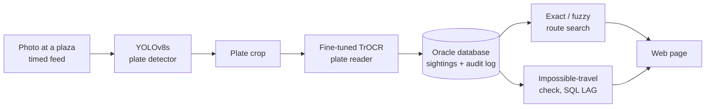

# Vehicle Route Tracker

**Find where a vehicle went by typing its number plate.** A plate detector and reader turn timed toll-plaza photos into
database records, and a fuzzy search follows a vehicle across plazas even when the reader gets a character wrong.

**Live demo:** _paste your Streamlit link here_

<!-- After you add a screenshot to docs/demo.png, delete this line and the closing arrow, and the picture will show:

-->

> **All data is simulated.** The cars, plazas, routes and times are generated from a public photo dataset of Indian
> number plates. There is no real toll-plaza footage. The live demo runs on an anonymized snapshot (see
> [Data and privacy](#data-and-privacy)).

## Results at a glance

| | Result |
|---|---|
| Plate reader, exact plate match on 180 held-out photos | **14.4% (off-the-shelf EasyOCR) to 86.7% (fine-tuned TrOCR)** |
| Plate detector recall on held-out cars | **0.989** (precision 0.981) |
| Route search, 20 tracked cars | **91% found with exact match, 100% with fuzzy match** |
| Fuzzy plate search on 1M rows in Oracle | **about 4.1 s to about 27 ms (~150x)**, results identical to a full scan |

Accuracy figures come from small sets, so read them as "about". See [Limitations](#limitations).

## What it does

- **Reads plates:** a fine-tuned YOLOv8s finds the plate in a photo and a fine-tuned TrOCR reads it.
- **Stores every sighting in Oracle** with its plaza, time and confidence, and logs every search in an audit table.
- **Follows a vehicle:** type a plate and see the plazas it crossed in order, the minutes between them and the speed.
- **Tolerates misreads:** fuzzy matching finds sightings where one character was read wrongly.
- **Flags impossible trips:** a leg faster than 130 km/h, or two places at the same moment, may mean a cloned or misread plate.

## How it works

1. **Simulated feed:** four plazas on one highway (km 0, 40, 95 and 150) each receive a photo every 20 minutes from 09:00.
   Twenty tracked cars visit two to four plazas in order with realistic travel times, mixed with one-off cars.
2. **Detector and reader:** the detector is fine-tuned on about 1,000 Indian plate photos, the reader on the crops of the same photos.
3. **Database:** a PL/SQL procedure runs the route search and writes each search to an audit table.
4. **Fuzzy search:** two plates one edit apart always share their first three or their last three characters.
   Two small covering indexes use that to narrow a million rows to a few thousand